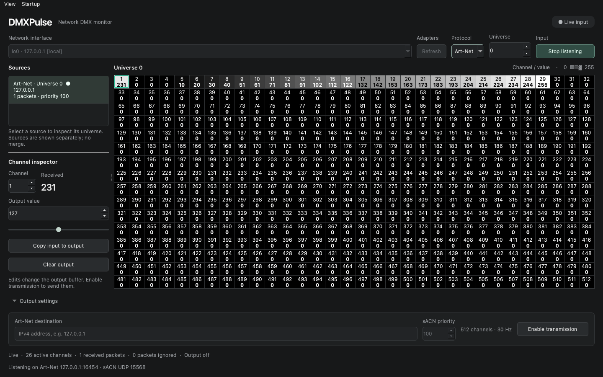

<h1 align="center">DMXPulse</h1>

<strong>See the signal. Find the problem. Take control.</strong>

A clear view of your Art-Net and sACN lighting network. 512 channels. Live values. No guesswork.

  <a href="https://github.com/PixelStereo/DMXPulse/releases">Download</a> ·
  <a href="#your-first-signal">Quick start</a> ·
  <a href="docs/guide.md">User guide</a> ·
  <a href="docs/build.md">Build from source</a>

  
  
  

## The whole universe, at a glance

Read a channel number and its value without opening another window. Every tile follows the actual received level: **black at 0, white at 255**, with text that stays readable across the range.

| Monitor | Inspect | Send |
|:---|:---|:---|
| See all 512 channels in one grayscale view. | Select a channel to compare received and prepared values. | Shape levels with a rotary encoder, fine steps or an exact value. |
| Choose an interface, protocol and universe. | Merge received sources with HTP or LTP. | Follow input and override individual channels. |
| Spot live, stale and missing input immediately. | Open network diagnostics when you need more detail. | Enable transmission explicitly, at approximately 30 Hz. |

**The grid tells the truth.** It only shows data received through the network. Turning the encoder prepares the output; it changes the grid only when the resulting packets are actually received.

## Take it where you work

Packages are attached to [tagged releases](https://github.com/PixelStereo/DMXPulse/releases).

| Device | Package |
|:---|:---|
| Mac · Apple Silicon or Intel | `.dmg` or `.zip`, with the Qt runtime included |
| Windows · 64-bit | Portable `.zip`, with runtime dependencies |
| Linux · Debian 12 / compatible Ubuntu desktop | `amd64.deb` |
| Raspberry Pi · 64-bit Raspberry Pi OS Bookworm desktop | `arm64.deb` |
| Android · 64-bit, Android 9+ | Installable `.apk`, with a touch-oriented workspace |
| iPhone / iPad | Simulator and unsigned device builds; an installable IPA is added when Apple signing is configured |

macOS packages use an ad-hoc signature unless a distribution signing pipeline is added. iOS device installation requires appropriate Apple signing and provisioning. Android packages use a CI test key until a persistent release key is configured. See the release notes and [installation guide](docs/guide.md#installation) before installing.

## Your first signal

1. **Choose your interface.** Select the adapter connected to your lighting network.
2. **Choose a protocol and universe.** Art-Net starts at universe **0**; sACN starts at **1**.
3. **Start listening.** Select a detected universe to inspect its channels.

For a same-device loopback test, choose the local `127.0.0.1` adapter and use `127.0.0.1` as the Art-Net output destination. Prepare a channel value, then enable transmission. A returned packet is required before that value appears in the grid.

## Pick up where you left off

Your adapter, universe, addresses, levels, selected channel and workspace layout are saved automatically. Startup options let you resume listening and optionally transmission. The universe list, monitor and output controls share one workspace. On phones and tablets, the panels stack vertically.

## Small details that matter

- One view per universe, with a saved HTP/LTP choice for each universe and sACN priority handling.
- A detachable timestamped journal identifies incoming sources and outgoing packets.
- No packet means **—**, rather than a value that looks like a received zero.
- Stale input is clearly marked while the last values remain visible.
- Multicast reception follows the selected sACN universe.
- Output and reception remain independent, even during local loopback.

Need a hand? Read the [user guide](docs/guide.md) or [report an issue](https://github.com/PixelStereo/DMXPulse/issues). Developers and release maintainers can find everything in [docs/build.md](docs/build.md).

---

Made by **PixelStereo** · [MIT license](LICENSE) · [Third-party notices](THIRD-PARTY-NOTICES.md)

Art-Net™ Designed by and Copyright Artistic Licence.
